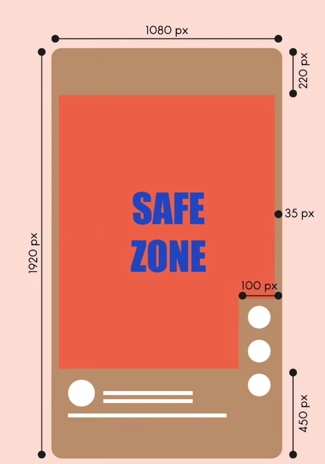

# Design rules: videos that don't look AI-made

Rules Claude follows on every video so it looks made by a person with taste.
Most of them came from real drafts that were sent back. Each rule says where it
came from, so you can read the full context.

**Your rules win.** The operator's saved edit rules
(`.claude/skills/video-edit/references/edit-rules.md`) and a chosen style in
`styles/` override anything here. These are the defaults when nobody has said otherwise.

Sources, shortened:

| Tag | File |
|---|---|
| **[yap]** | `recipes/yap.md` (Yap formula, dated rules from real feedback) |
| **[check]** | `recipes/yap-release-check.md` (yes/no release checks) |
| **[flash]** | `recipes/flash-overlays.md` |
| **[audio]** | `recipes/yap-audio.md` |
| **[safe]** | `instagram-safe-zone.md` and `references/instagram-safe-zone.png` |
| **[motion]** | Motion studio house rules (`motion-studio/node/CLAUDE.md`, from the motion-301 studio) |
| **[ed-tech]** / **[yap-depth]** / **[oren]** | `styles/<name>/STYLE.md` |
| **[70]** | `parts/70-playbook-and-failures.md` |
| **[timing]** | `.claude/skills/overlay-timing/SKILL.md` |
| **[dataviz]** | Claude's dataviz skill (chart rules) |
| **[general]** | Common practice, not from this repo. Use as a starting point |

---

## 1. Type

### Safe zone (1080 x 1920) [safe]

- Instagram covers the **top 220 px**, the **bottom 450 px**, **35 px** on each
  side, and a **100 px strip on the right** beside the like/comment buttons in the lower part.
- **Keep all text, faces and must-read content inside x 35–980, y 220–1470.**
  Leave breathing room inside that too.
- **Cards, screenshots, chips and title blocks: x 135–880** (an extra ~100 px
  each side). Include the card's border and shadow in the fit. [flash] [yap]
- Backgrounds may bleed to the edges. Only text and essentials must stay inside.
- Scale proportionally for other sizes. For 4:5 (1080 x 1350, cut from the
  middle of the 9:16), keep anything that must survive inside y 285–1635. [yap]
- **Check, don't assume.** Lay the safe-zone overlay on real frames, and test a
  1.05x and 1.10x zoom crop for left-edge clearance. [flash] [check]
- This is the user's layout guide, not an official Instagram measurement. TikTok
  and YouTube Shorts are similar but not identical [general].

### Sizes at 1080 wide

| Text | Size | Source |
|---|---|---|
| Hook title (Yap) | 104 px, Orbitron Bold. Up to 112 px on one line for a versus title; 92 px was rejected as too small | [yap] |
| Hook title (Editorial Tech) | 120–160 px, heavy italic sans | [ed-tech] |
| Word-by-word captions | 66 px (Orbitron) or ~46 px (Space Grotesk), one line | [yap] |
| List chips | 46 px text, 54 px logo, 72 px tall. 34 px was rejected as far too small | [yap] |
| Anything important | Never smaller than 48 px | [motion] |
| Body or label text in a graphic | 40 px minimum; 48+ preferred | [general] |

**When in doubt, go bigger.** "Too small" is the single most common note in the
repo's feedback log. The creator preferred chips covering his forehead over small chips. [yap]

### How many words

- **Hook title: at most 3 words, at most 7 letters a word, aim for 12–14
  letters total.** Title Case. [yap]
- **A text card: one complete headline or short line, about 12 words or 3 lines
  maximum.** Never a paragraph excerpt, never cut mid-word or mid-sentence. [check]
- **Captions: 1–4 words at a time** (phrase style) or one word at a time. [ed-tech] [yap]
- **Added text is the hook only**, unless the operator asks for more. No word
  cards standing in for a real image. [yap]

### Contrast and finish

- White lettering with a strong dark shadow or outline over footage. The Yap
  title adds a soft glow. **No black panel or bubble behind the title.** [yap]
- Text over a busy area: darken that area a little (soft shade) rather than adding a box. [yap]
- Aim for at least 4.5:1 contrast between text and what sits behind it
  (WCAG AA), 3:1 for very large text [general]. Check on a phone, in sunlight if you can.
- Spell captions from the script, never from Whisper. Drop commas and full
  stops in captions; keep question marks. [yap]
- **Two typefaces maximum: one display face, one UI face.** [motion]
- Centre the title on the frame (x 540), not on the safe area, with its
  lettering still inside x 35–980. [check]

### Placement

- The **title leads the composition**. Place it first, then build the visual around it and the head. [yap]
- Title directly above the moving head, with a visible gap above the hair. [yap]
- Captions as low as the safe area allows (text ending just above y 1470): under the chin, never on the face. [yap]
- A title over a card is either fully inside it or fully outside with a gap, never on the card's edge. [yap]
- Keep at least ~20 px between any two elements, and around the face. Nothing touches. [yap]

---

## 2. Colour

- **One accent colour** unless the brief says otherwise. [motion]
- Build from: one background tone (often dark charcoal, not pure black), one
  text colour (white or off-white), one accent for the thing that matters. [ed-tech]
- **Use the accent for one job:** the selected state, the number that matters,
  the line that wins. If everything is accent, nothing is. [ed-tech] [dataviz]
- Brand colours live in `engine/src/brand.mjs`. Use them; don't invent a palette. [CLAUDE.md]
- Logos stay in their own brand colours, background removed: no white box, no app tile. [yap]
- A colour named after a real thing ("Nickelodeon slime") must match a reference photo of that thing. [check]
- **Not every card is white.** A dark panel, or no panel at all, often looks better. [yap]
- Contrast: text at least 4.5:1 against its background [general]. Never use
  colour alone to carry meaning; add a label or shape. [dataviz]
- Avoid indiscriminate neon and glow. [ed-tech]
- **Take the AI shine off generated footage:** lower contrast and saturation, lift the blacks, add 3–8% grain. `engine/scripts/grade.py` does this. Clean is the tell. [70]

---

## 3. Motion and timing

### Durations in frames

| Move | Seconds | At 30 fps | At 60 fps | Source |
|---|---|---|---|---|
| Entrance | 0.2–0.4 s | 6–12 | 12–24 | [ed-tech] |
| Exit | 0.13–0.27 s | 4–8 | 8–16 | [ed-tech] |
| Stagger between related items | 0.07–0.13 s | 2–4 | 4–8 | [ed-tech] |
| Quick punch-in, settles | 0.2–0.33 s | 6–10 | 12–20 | [ed-tech] |
| Slow push (100% to 105%) | 2–4 s | 60–120 | 120–240 | [ed-tech] |
| One caption word, minimum | 0.1 s | 3 | 6 | [yap] |
| Exit allowance after the last relevant word | 0.15–0.3 s | 5–9 | 9–18 | [timing] |

Exits are faster than entrances. Draft at 30 fps; the motion studio's final renders at 60 fps with motion blur. [motion]

### Easing [general]

- Entrances: **ease-out** (fast start, gentle stop), e.g. `cubic-bezier(0.16, 1, 0.3, 1)`.
- Exits: **ease-in** (gentle start, fast leave), e.g. `cubic-bezier(0.7, 0, 0.84, 0)`.
- Moving from one place to another on screen: **ease-in-out**.
- **Never linear** for things that move, except constant scrolls and counters.
- **Spring or bounce only for one thing that earns it.** Bouncing everything is a banned look.

### Reading holds

- **Simple image:** at least 1.0 s, usually 1.5 s. [timing]
- **Chart or detailed evidence:** 3–5 s or more. [timing]
- **Text:** allow about **3–4 words a second** for short text, plus about half a
  second to find it [general; matches the 12-word / 3-line card limit].
  Anything that can't be read in its hold is too long: cut words, don't extend forever.
- Hold through the final relevant spoken word, then a short exit. [timing]

### Pace (screen-change cadence)

- **Yap videos: the screen changes about every second.** A still or card holds
  about 1 s; an animation runs up to about 3 s; nothing, including clean
  footage, holds longer than about 3 s. [yap, 25 Oct]
- **Motion graphics: something new every 2–4 seconds.** [motion]
- **Editorial Tech: never 3 full seconds with no overlay, animation or background change.** Full-screen flashes 1.5–2.5 s, never back to back. [ed-tech]
- **Static Hooks: a meaningful change every 2–3 s.** [oren]
- Vary it. **No fixed periodic rhythm**; follow the meaning of the speech. [yap]
- An 8-second spoken beat gets a run of different visuals, not one held card. [yap]

### One idea per shot

- Each visual shows the exact spoken claim or action, not just a noun that was mentioned. [yap]
- Two back-to-back overlays should not be the same kind of thing (two headlines in a row). [check]
- Every image in a video is different from every other one. [check]

### Beat-matching and starts

- Put hits on the measured beat grid (`beats.json`, or `BEAT` in the film) and on the cuts. [motion]
- **Animations are already moving on their first frame.** No blank card waiting for its cue, no idle pulse standing in for a start. [yap]
- Video overlays keep moving until they leave. Never let a clip finish and freeze. [yap]
- Default transition is a **hard cut**. Don't dissolve everything. [yap] [ed-tech]
- Write cues in source time and map them through the cut map, so a speed change never needs retiming. [yap]

---

## 4. Composition (vertical)

- **Keep the presenter's original framing.** Don't shrink them, move them to a
  corner or swap their background unless the operator asked for that scene. [yap]
- **Faces:** never cover eyes or mouth. Anything drawn in front keeps a gap
  above the head. Check moving head and hands at the entry, middle and exit of each overlay. [yap] [check]
- **Depth:** original video, then the visual, then a cut-out copy of the
  presenter on top, so images sit "halfway behind" the head. The head may hide
  decorative parts only, never text, numbers or the action. [yap] [flash]
- **Big once the title is gone:** an image runs the full safe width (about 60 px side borders at 1080) from the top safe line down behind the head. [yap]
- **Centre overlays in the band** between the top safe line (y ≈ 226) and the top of the hair. Don't park them against the safe line. [yap]
- **Fill the space.** Small chips floating in a big empty band fail. When the head is low, overlays get bigger. [yap]
- **Green screen** (full-screen visual with the presenter's cut-out): presenter
  at about 60–65% size, flush with the bottom-left or bottom-right edge. Never
  floated. The background must be rich and full-frame, never one small card on an empty field. [yap] [safe]
- **Close-up footage** (head fills the top half): use fewer overlays. Title, face and voice can be the whole hook. [yap]
- **Rule of thirds** [general]: put eyes on the upper third line. In 9:16 that
  is around y 640, which also sits well below Instagram's top 220 px.
- **Negative space** [general]: one strong subject per frame beats five weak
  ones. Empty space around a headline is what makes it read. But see "fill the
  space" above: empty space should be deliberate, not leftover.
- Before rendering anything, check which way the speaker points, and put things on that side. [yap]
- Text reading backwards in the footage (a hat, a sign) means the footage is mirrored. Flip it. [check]

---

## 5. Banned looks (the "AI slop" tells)

If a frame matches one of these, change it.

| Tell | Instead | Source |
|---|---|---|
| Centred title on a gradient | A real image, footage, or a composed layout with the title placed for a reason | [motion] |
| Purple-to-blue gradients, neon on black | The brand palette with one accent | [general] [ed-tech] |
| Everything fading in | Hard cuts, slides with intent, a build that explains something | [motion] |
| Bouncy or elastic easing on every element | Ease-out entrances; one spring at most | [general] |
| Glassmorphism (frosted panels) on everything | Solid dark panel, or no panel | [general] [yap] |
| Glow on UI chrome, corner labels, frame borders | Plain, finished elements | [motion] |
| Generic particle bursts and floating geometry | A visual mechanism that explains the point | [motion] [ed-tech] |
| Stock photo that just names the noun (a laptop for "work") | An image that shows the claim | [yap] |
| Random stock portraits, offices, handshakes | The real thing: the headline, chart, product, screenshot | [flash] [yap] |
| White rounded cards everywhere | Dark panel or no background | [yap] |
| Text chips labelling a concept | The real reference (article, chart, product page) | [yap] |
| Flat placeholder shapes (bars standing in for text lines, empty panels) | High-fidelity, finished-looking animation, or a real image | [yap] |
| Abstract animation as the hook | A frame-zero visual that names the topic without audio | [yap] |
| Emoji | Never | [flash] [yap] |
| Overused fonts used without thought (default Inter for everything, Poppins, Montserrat) | Pick a face for the brand; two faces max | [general] [motion] |
| Too-clean, glossy, high-contrast AI footage | Grade in code: lower contrast, lift blacks, add grain | [70] |
| Invented UI, fake data, fake screenshots | Real screenshots or nothing | [yap] [motion] |
| Borrowed logos (a related company's mark) | The product's own official mark, or its name in text | [yap] |
| Another platform's watermark on footage | Remove or replace it | [yap] |

Also banned for distribution reasons, from a reel that got zero views: nudity or
gore of any kind (including museum pieces and art), piracy brands, and
re-uploading an identical file after deleting a post. [yap]

Never use an image whose licence requires a credit (CC BY, CC BY-SA). Use
public domain or CC0, official press assets, or your own screenshots. [yap]

---

## 6. Charts that animate

Chart rules from the dataviz skill, adapted for a phone screen. [dataviz] unless marked.

- **Pick the form first.** Is it one number? Then it is a big number, not a
  chart. Change over time is a line. Comparison is a bar. A proportion ("90%
  you don't need") is a grid of squares switching off. [yap] [dataviz]
- **Draw it on as it is spoken.** Bars grow from the baseline, lines draw left
  to right, tiers of a funnel appear as each is named. [yap]
- **Count numbers up** to their final value, ending on the spoken word, then hold [general].
  Use ease-out so the count slows into the final number.
- **Label directly** at the end of the line or bar. No legend for one series. A
  legend only when there are 2 or more, and keep series to 4 or fewer on a phone.
- **One highlight colour.** Everything else in grey. The highlight is the point of the chart.
- **Never two y-axes.** Two measures of different scale make two charts.
- **Thin, clean marks.** Faint gridlines, or none. Round the data ends of bars slightly.
- **Text in text colours,** not in the series colour.
- **Keep the chart's real title and source** when you use a real chart. A cut-off chart crop fails. [check]
- **The chart alone,** without the article page around it. [check]
- **Reading hold: 3–5 s or more.** If it won't read in that time, simplify it or drop it. Never flash a dense chart. [timing] [ed-tech]
- **Never invent data points,** in-between values or results. [flash] [motion]
- Real charts can still animate: reveal them left to right. [yap]

---

## 7. Audio

| Target | Value | Source |
|---|---|---|
| Integrated loudness | **-14 LUFS** | [yap] [audio] [motion] |
| True peak | **at or under -1.5 dBTP** | [yap] [audio] |
| Dialogue speed (Yap) | 1.07x, pitch kept; 1.05x if rushed | [yap] |
| Gap between phrases (Yap) | 0 ms default; 20–120 ms if it feels rushed | [yap] |
| Fades at each audio join | 12 ms | [audio] |
| Sound effects under voice | about 30 dB below the voice | [yap] |
| Music bed under voice | duck so the voice always leads; start around -20 dB below dialogue [general] | |

- **Clean, then polish, then cut, then level.** DeepFilterNet; high-pass 80 Hz,
  -2 dB at 250 Hz, +2 dB at 3.5 kHz, de-esser, gentle compressor (3:1 at -22 dB);
  then cut; then gain plus a limiter to -14 LUFS. [audio]
- **Cut breaths, ums, laughs, mouth clicks and restarts.** Silence detection
  alone misses them; check every sound between words. [yap]
- **Sound effects only on request.** When used: short whoosh on a big
  transition, soft click on a selection, small tone on a completion. Not on every cut. [yap] [ed-tech]
- **Pitch above ~400 Hz** so a phone speaker can play it. **Measure that the effect is really in the file.** [yap]
- **Music you own only.** `engine/scripts/bed.py` composes an original bed. Never a found track. [70]
- **J-cuts and L-cuts** (sound leading or trailing the picture) plus one continuous room tone make a scene feel real. [70]
- **A human listens before it ships.** Numbers don't tell you if it sounds right. [70] [audio]

---

## 8. Pre-export checklist

Run this before showing a draft. Answer each line yes or no, from a real frame
or measurement, not from the plan. Ideally a fresh session runs it. [check]

**Look at it first** [motion]
- [ ] Made a contact sheet (`ffmpeg ... tile`, or `node stills.mjs`) and looked at it.
- [ ] Scored it 1–10 on: hook in first 2 s, readability at phone size, motion quality, variety, brand accuracy, sound sync. Fixed the worst three. Everything 8+.

**Opening**
- [ ] Frame zero has a substantial visual that says what the video is about without sound. [yap]
- [ ] Hook title: at most 3 words, big, clear of the face, above the head. [yap]

**Type and layout**
- [ ] All text and faces inside x 35–980, y 220–1470. Cards inside x 135–880. [safe]
- [ ] Nothing important under 48 px at 1080 wide. [motion]
- [ ] Every text card read at full size: complete, no cut-off words, ≤ 12 words. [check]
- [ ] No emoji. No `[BRACKETED]` placeholders on any frame. [yap] [CLAUDE.md]
- [ ] Nothing touches: gaps between title, cards, logos and the face. [yap]

**Content**
- [ ] Every visual shows the claim, not just the noun. [yap]
- [ ] Everything is real: no invented UI, data or screenshots. Logos are the right product's own mark. [yap]
- [ ] No image needs a credit; no nudity, gore, piracy or other platforms' watermarks. [yap]
- [ ] Animations meet a high craft bar, not flat placeholder shapes. Looked at full size. [yap]

**Pace**
- [ ] Screen changes at the style's cadence (about every second for Yap; 2–4 s for motion graphics). Nothing static over ~3 s. [yap] [motion]
- [ ] Every animation is moving on its first frame. No overlay freezes before it leaves. [yap]
- [ ] Charts and must-read text held long enough to read. [timing]

**Sound**
- [ ] Measured: -14 LUFS integrated, true peak ≤ -1.5 dBTP. Report the numbers. [audio]
- [ ] No breaths, ums or clipped word edges at joins. [check]
- [ ] Captions match the script word for word (re-transcribe the finished file). [yap]
- [ ] **The operator has listened to the whole file.** [70]

**Delivery**
- [ ] Draft at 720p; final 1080p only on approval. [yap]
- [ ] H.264, yuv420p, AAC, 9:16 (plus 4:5 for ads). 4:5 checked separately. [motion] [CLAUDE.md]
- [ ] A 9:16 cover exists and survives the 4:5 and 1:1 thumbnail crops. [yap]
- [ ] File name follows `parts/80-naming-and-delivery.md`. [CLAUDE.md]

**When a draft is rejected for a reason not on this list,** add it as a dated
yes/no line (the `refine-video-edit` skill does this). That is how every rule
above got here.
